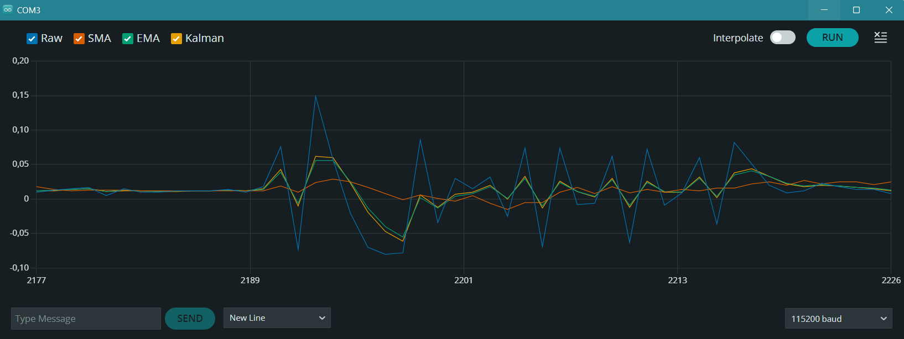
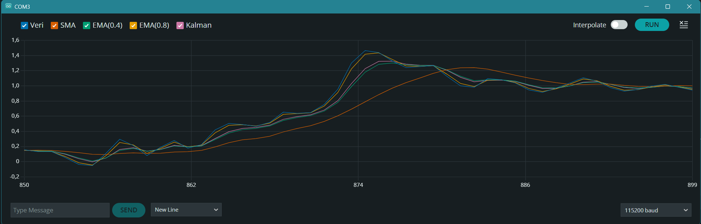

# Real-Time IMU Signal Filtering Benchmark on ESP32 (FreeRTOS)

Comparative evaluation of real-time digital filtering algorithms applied to raw acceleration data from an MPU-6500 6-axis IMU via I2C at 50 Hz.

This project benchmarks **Simple Moving Average (SMA)**, **Exponential Moving Average (EMA)** with different alpha coefficients, and a discrete **1D Kalman Filter** directly on the ESP32 to evaluate latency (phase lag) vs. noise attenuation trade-offs.

---

## 📈 Real-Time Filter Response & Telemetry Analysis

The following serial plots compare the transient response, noise reduction, and phase lag across identical accelerometer input sequences sampled at 50 Hz (`115200 baud`).

### 1. High-Frequency Noise & Oscillation Rejection


* **Raw Data (Blue):** High jitter and raw sensor noise.
* **SMA N=10 (Orange):** Heavily attenuates rapid oscillations, but flattens high-frequency signal dynamics.
* **EMA $\alpha=0.8$ (Yellow):** Highly responsive with minimal delay, but lets high-frequency jitter pass through.
* **EMA $\alpha=0.4$ (Green) & Kalman (Purple):** Deliver an optimal balance by filtering out sharp spikes without sacrificing overall dynamic trend.

---

### 2. Step Response & Phase Lag (Transient Motion)


* **Phase Lag Demonstration:** During sudden acceleration changes, the **SMA buffer introduces visible delay (phase lag)**, trailing far behind the actual motion curve.
* **Kalman vs. EMA Adaptation:** The **Kalman Filter** dynamically weights sensor covariance to track the rising edge with near-zero lag while suppressing noise floor vibrations.

---

## 📊 Algorithmic Comparison

| Filter Algorithm | Tuned Parameters | Latency / Phase Lag | Noise Attenuation | Memory Footprint | Computational Complexity |
| :--- | :--- | :--- | :--- | :--- | :--- |
| **Raw Accel** | N/A | None (0 ms) | Poor (Raw ADC Noise) | None | None |
| **SMA** | $N = 10$ samples | High (Buffer delay) | Moderate | Ring buffer ($N$ floats) | $O(N)$ sum / sliding window |
| **EMA ($\alpha=0.8$)** | $\alpha = 0.8$ | Very Low | Weak | Single state variable | $O(1)$ single MAC operation |
| **EMA ($\alpha=0.4$)** | $\alpha = 0.4$ | Low | Good | Single state variable | $O(1)$ single MAC operation |
| **Kalman Filter** | $Q=0.15, R=0.4$ | Minimal (Adaptive Gain) | Superior | State & Covariance floats | $O(1)$ dynamic gain calculation |

---

## 📌 Implementation Details

* **Target Hardware:** Espressif ESP32 (Xtensa LX6)
* **Sensor:** InvenSense MPU-6500 (I2C Master @ 400 kHz Fast Mode)
* **Sampling Architecture:** Deterministic 50 Hz task loop (`pdMS_TO_TICKS(20)`) managed by FreeRTOS.
* **Sensor Configuration:** Full-scale accelerometer range $\pm2g$ ($16384 \text{ LSB/g}$).

---

## 🚀 Build and Run

1. **Build and Flash via ESP-IDF:**
   ```bash
   idf.py build
   idf.py -p <PORT> flash monitor
